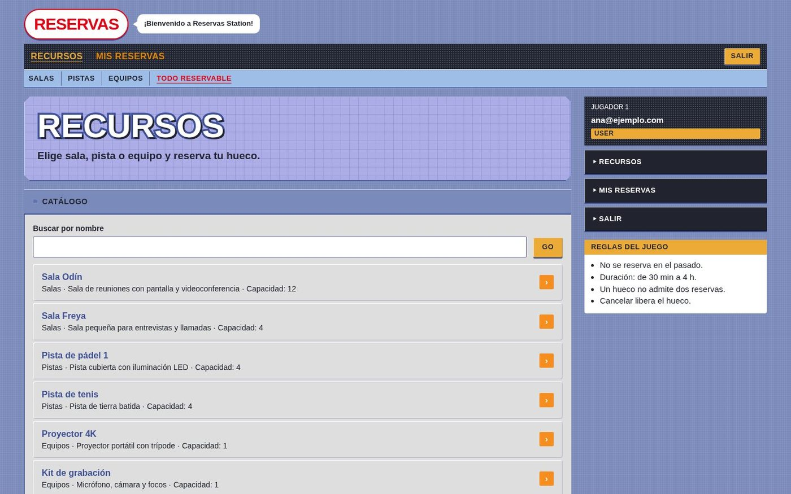
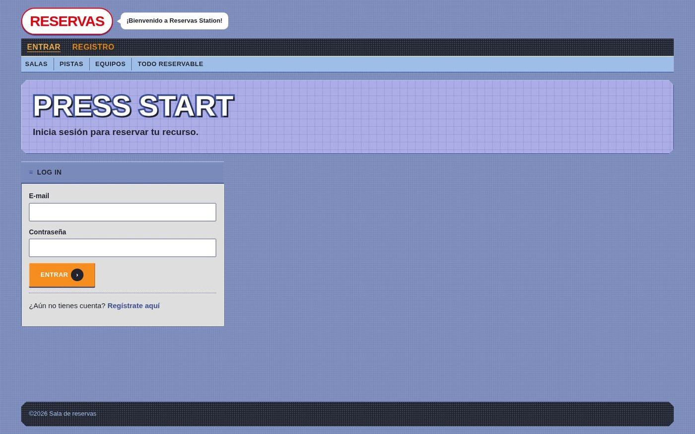
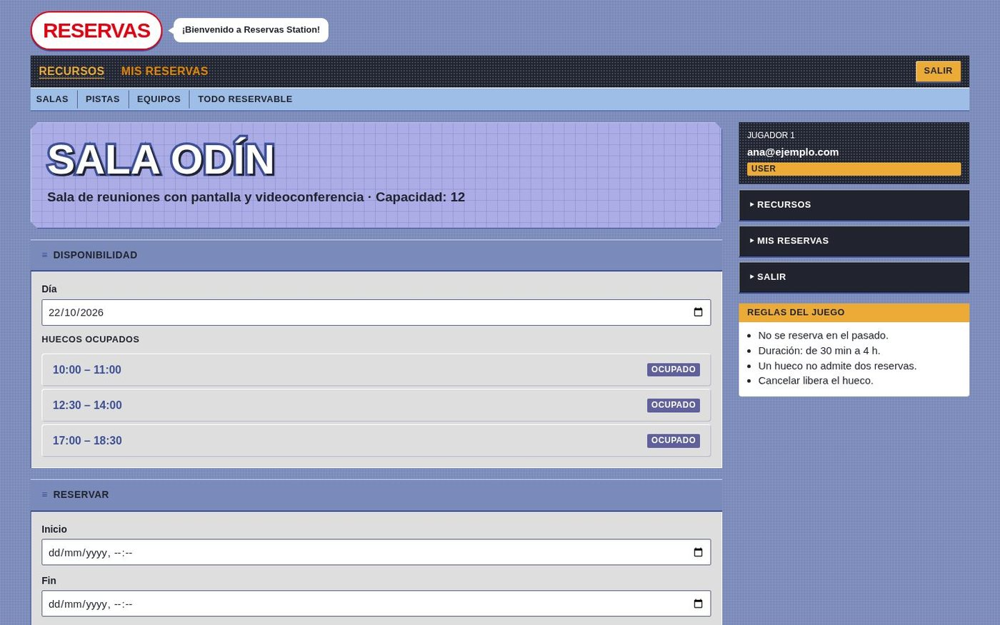
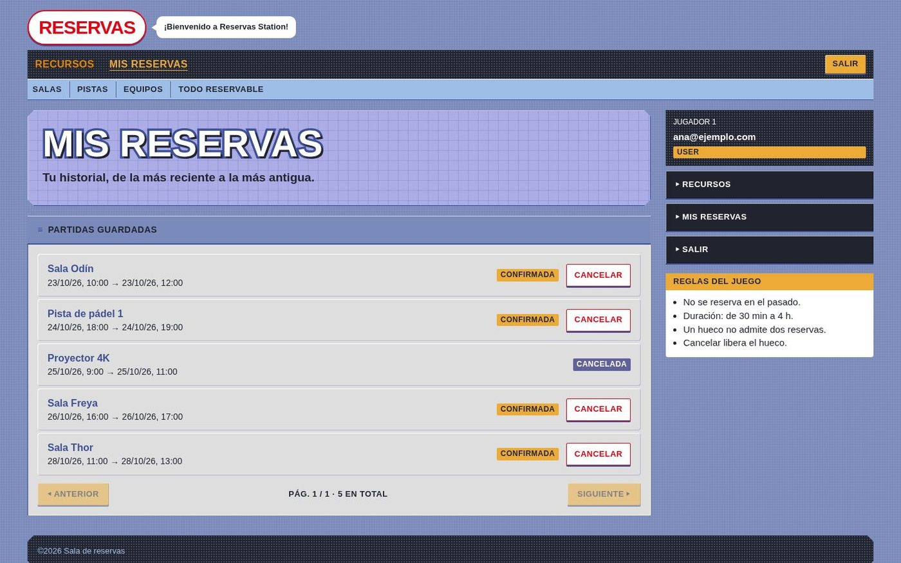
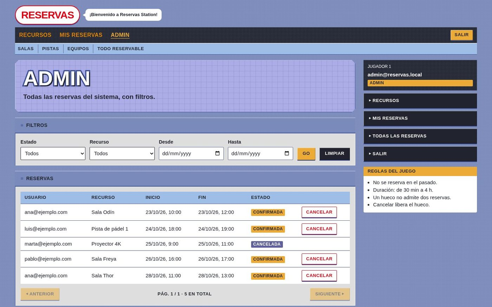

<h1 align="center">Reservas Station</h1>

<p align="center">
  <b>Reserva salas, pistas y equipos sin dobles reservas.</b><br>
  API REST en Java 21 + Spring Boot y cliente Angular con estética de Nintendo.com (2001).
</p>

<p align="center">
  <a href="https://app-reservas-ten.vercel.app"><b>Demo</b></a> ·
  <a href="https://reservas-api-nt3e.onrender.com/swagger-ui.html"><b>Swagger UI</b></a> ·
  <a href="#capturas">Capturas</a> ·
  <a href="#arranque-rápido-local">Arranque local</a>
</p>

<p align="center">
  
  
  
  
  
  
  
  
  
  
  
  
  
  
</p>

<p align="center">
  
</p>

> La API corre en el plan gratuito de Render y se duerme tras 15 minutos sin tráfico: la primera petición puede tardar entre 30 y 60 segundos. Puedes registrarte con cualquier e-mail y contraseña para probar como usuario.

## Qué hace

| | |
|---|---|
| **Usuarios** | Se registran, inician sesión, consultan la disponibilidad de un recurso por día, reservan y cancelan sus reservas |
| **Administradores** | Crean, editan y desactivan recursos, y ven y filtran las reservas de todos (por estado, recurso y fechas) |
| **Sin solapamientos** | Dos reservas confirmadas del mismo recurso no pueden coincidir: PostgreSQL lo impone con una restricción `EXCLUDE USING gist`, no solo la aplicación |
| **Seguridad** | JWT, contraseñas con BCrypt, roles `USER` / `ADMIN` y errores en formato `ProblemDetail` (RFC 9457) |
| **Responsive** | La tabla de admin pasa a tarjetas en móvil y la doble barra de navegación se funde en un menú |

## Capturas

<table>
<tr><td align="center"><br><sub><b>Inicio de sesión</b></sub></td><td align="center"><br><sub><b>Disponibilidad y reserva</b></sub></td></tr>
<tr><td align="center"><br><sub><b>Mis reservas</b></sub></td><td align="center"><br><sub><b>Panel de administración</b></sub></td></tr>
</table>

## Arquitectura

```
┌────────────────┐   HTTP + JWT   ┌────────────────┐   JDBC   ┌──────────────┐
│  reservas-web  │ ─────────────► │  reservas-api  │ ───────► │  PostgreSQL  │
│  Angular :4200 │ ◄───────────── │  Spring :8080  │          │  (Flyway)    │
└────────────────┘     JSON       └────────────────┘          └──────────────┘
```

| Carpeta | Qué es | Tecnologías |
|---|---|---|
| [`reservas-api`](./reservas-api) | API REST (backend) | Java 21, Spring Boot 3, Spring Security + JWT, Spring Data JPA, PostgreSQL, Flyway, Testcontainers, Docker |
| [`reservas-web`](./reservas-web) | Cliente web (frontend) | Angular 20, TypeScript, Reactive Forms |

### Decisiones de diseño
- **Sin doble reservado, en dos niveles:** el servicio comprueba el solapamiento para devolver un 409 claro, pero la garantía real es la restricción `EXCLUDE USING gist` sobre `tstzrange(start_at, end_at)` solo para reservas `CONFIRMED`. Un test lanza 10 peticiones simultáneas al mismo hueco y exactamente una se confirma.
- **Paquetes por funcionalidad** (`user`, `resource`, `reservation`) en vez de por capa técnica; controlador → servicio → repositorio, y DTOs como `record` sin exponer entidades JPA.
- **Fechas** como `Instant` / `timestamptz`: un instante absoluto, sin ambigüedad de zona.

## Arranque rápido (local)
Docker y Node.js 20+.

```bash
cd reservas-api
docker compose up --build        # API :8080 + PostgreSQL

cd reservas-web
npm install
npm start                        # http://localhost:4200
```

Administrador inicial solo para desarrollo: `admin@reservas.local` / `admin-local-1234`.

## Tests
```bash
cd reservas-api && ./mvnw verify     # requiere Docker (Testcontainers)
cd reservas-web && npm run build
```
Ambos se ejecutan en GitHub Actions (`.github/workflows/ci.yml`) en cada *push* y *pull request*.

## Despliegue
| Pieza | Plataforma | Configuración |
|---|---|---|
| API | Render (Docker) | [`render.yaml`](./render.yaml) |
| Base de datos | Neon (PostgreSQL) | variables `DB_URL`, `DB_USER`, `DB_PASSWORD` |
| Web | Vercel | [`reservas-web/vercel.json`](./reservas-web/vercel.json) |

## Documentación de cada parte
- [`reservas-api/README.md`](./reservas-api/README.md): endpoints, variables de entorno y decisiones de diseño.
- [`reservas-web/README.md`](./reservas-web/README.md): funcionalidades, estructura y contrato con la API.

---
<p align="center">Proyecto personal de <a href="https://github.com/Alejandro-Plata">Alejandro Plata Cortés</a></p>
